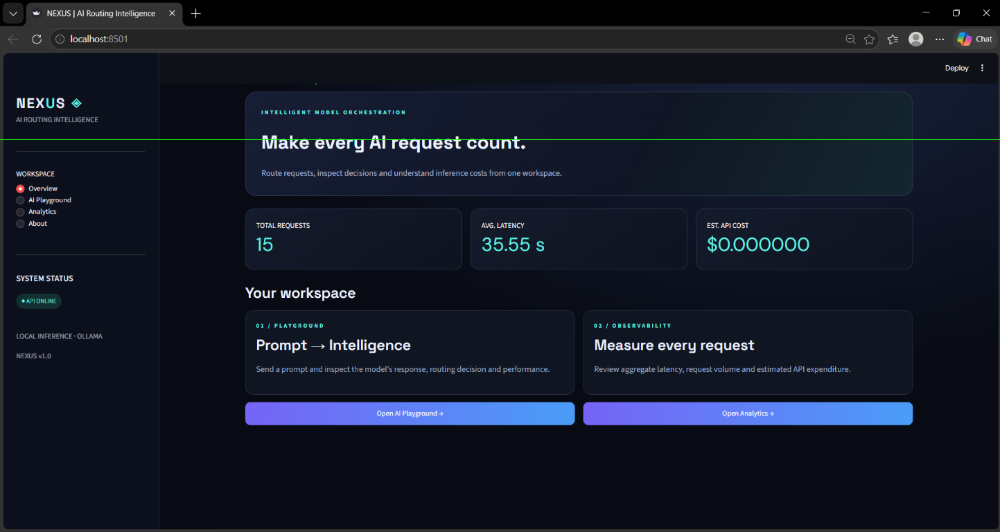
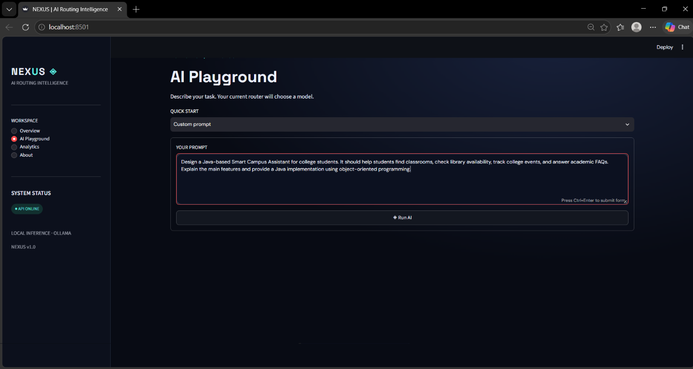
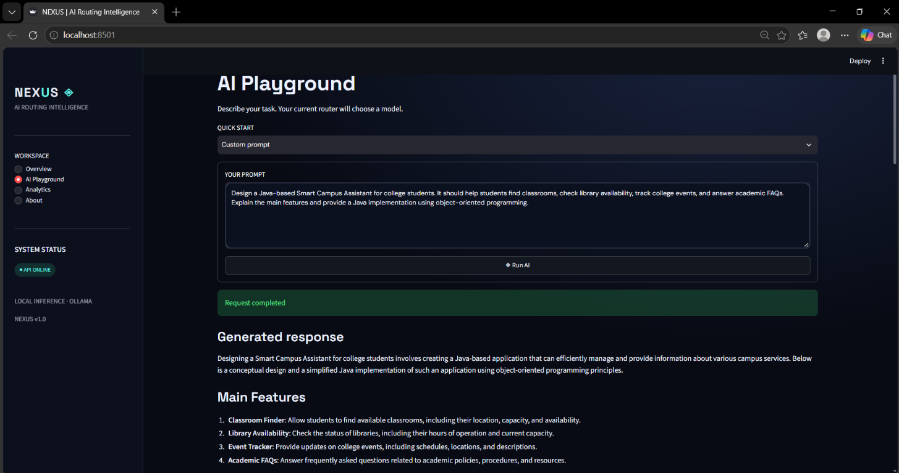
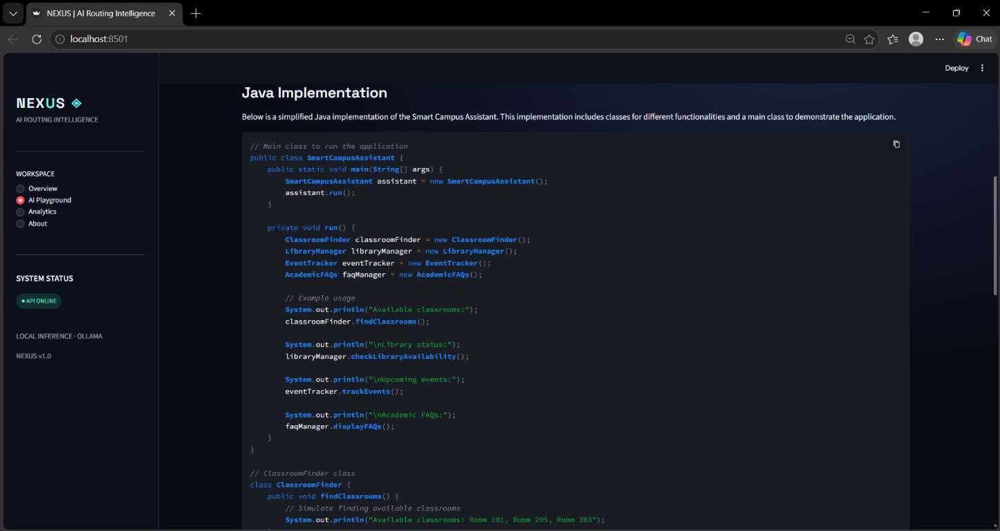
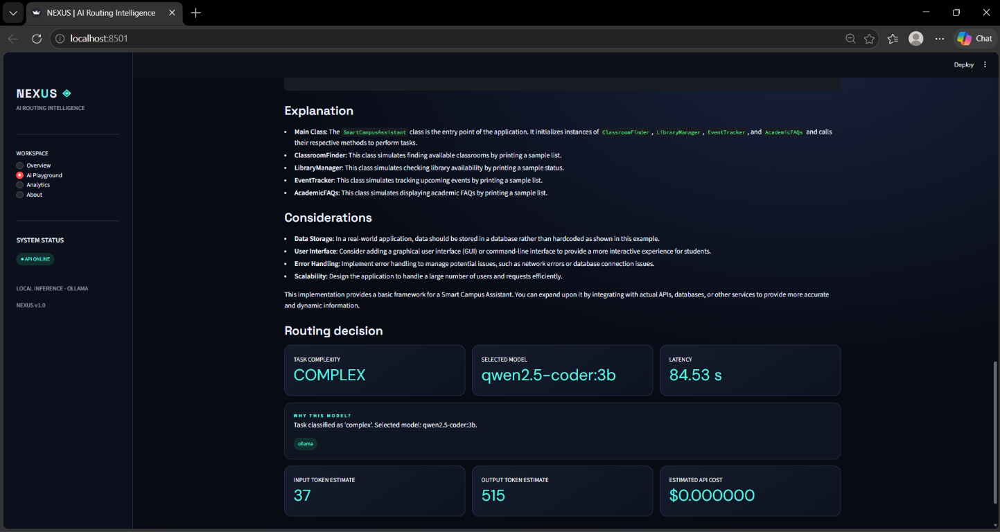
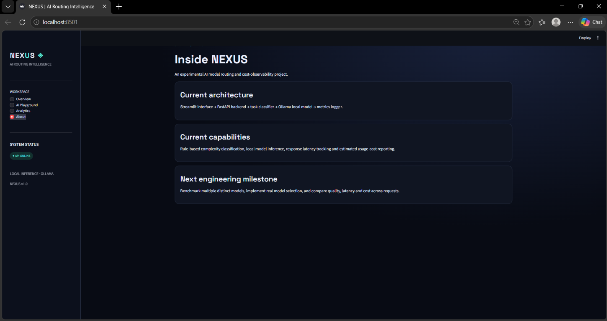
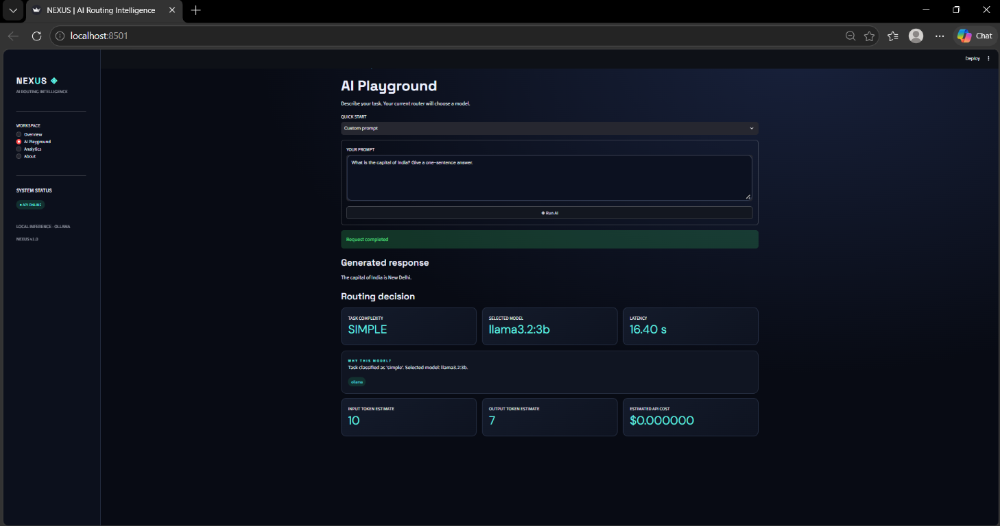

# 🚀AI Model Router & Cost Optimizer

An intelligent AI routing system that automatically selects a suitable local language model based on the type and complexity of a user request.

## 📌Overview

Running every AI request through the same model may not be the most efficient approach. This project routes requests to different locally hosted models based on simple task-classification rules.

It provides an interactive AI Playground, model-selection explanations, response generation, and request analytics.

## ✨Key Features

- **Automatic Model Routing:** Selects a model based on task classification.
- **Multi-Model Support:** Supports Llama 3.2 3B and Qwen 2.5 Coder 3B through Ollama.
- **Task Classification:** Categorizes prompts as simple, medium, or complex.
- **Interactive AI Playground:** Submit prompts and view generated responses.
- **Request Analytics:** Tracks request count, response latency, estimated token usage, and estimated API cost.
- **REST API:** Provides endpoints through FastAPI.
- **Local Inference:** Runs supported models locally using Ollama.

## 🛠️Tech Stack

- Python
- FastAPI
- Streamlit
- Ollama
- Llama 3.2 3B
- Qwen 2.5 Coder 3B
- HTTPX

## 🏗️Architecture

1. The user submits a prompt through the Playground or API.
2. The router classifies the task.
3. A suitable installed model is selected.
4. Ollama generates the response.
5. Request metrics are recorded and exposed through analytics.

## 🚀Getting Started

### 📋Prerequisites

- Python 3.11
- Ollama
- Git

### 1. Clone the repository

```bash
git clone https://github.com/YOUR_USERNAME/AI-Model-Router.git
cd AI-Model-Router
```

### 2. Create and activate a virtual environment

Windows PowerShell:

```powershell
python -m venv venv
.\venv\Scripts\Activate.ps1
```

### 3. Install dependencies

```powershell
pip install -r requirements.txt
```

### 4. Download the models

```powershell
ollama pull llama3.2:3b
ollama pull qwen2.5-coder:3b
```

Ensure Ollama is running before testing the application.

### 5. Start the API

```powershell
python -m uvicorn src.api:app --reload
```

API documentation: http://127.0.0.1:8000/docs

### 6. Start the Playground

Open a second terminal, activate the virtual environment, and run:

```powershell
python -m streamlit run app.py
```

## 🔌API Endpoints

| Method | Endpoint | Purpose |
|---|---|---|
| GET | `/` | Check API health |
| POST | `/chat` | Submit a prompt and receive a response |
| GET | `/analytics` | View request analytics |

## 💡Example

A general knowledge prompt can be routed to `llama3.2:3b`, while a coding prompt can be routed to `qwen2.5-coder:3b`, depending on the configured routing rules.

## ⚠️Current Limitations

- Routing is based on rule-based task classification.
- Local model performance depends on available hardware.
- Token counts are estimates.
- The current local Ollama configuration reports zero API charges; this does not account for hardware or electricity costs.
- Cost savings have not yet been benchmarked against a paid API baseline.

## 🔮Future Improvements

- Add paid API model providers and compare actual request costs.
- Benchmark model latency and response quality.
- Improve task classification and fallback handling.
- Expand automated tests and routing evaluation.

## 📄License

This project is licensed under the MIT License. See the [LICENSE](LICENSE) file for details.

## 📸Screenshots

### Overview


### AI Playground


### Generated Response


### Java Implementation


### Routing Decision


### About


### Simple Request Routing



## 👩‍💻 Author

**Keerthana Dhandapani**  
Computer Science and Engineering Student

- GitHub: https://github.com/Dhandapanikeerthana
- LinkedIn: https://linkedin.com/in/keerthana-d-07839531a/

---

⭐ If you find this project useful, consider giving it a star!
